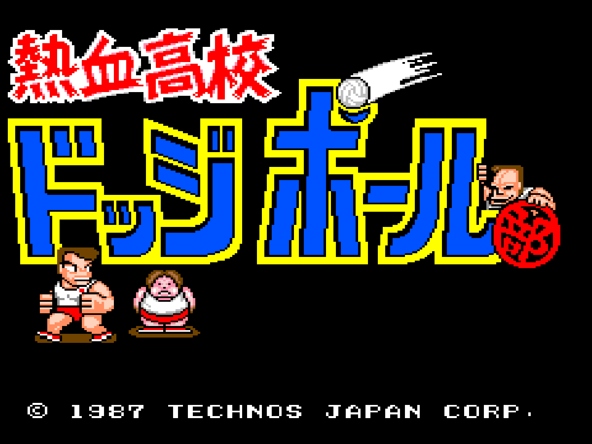
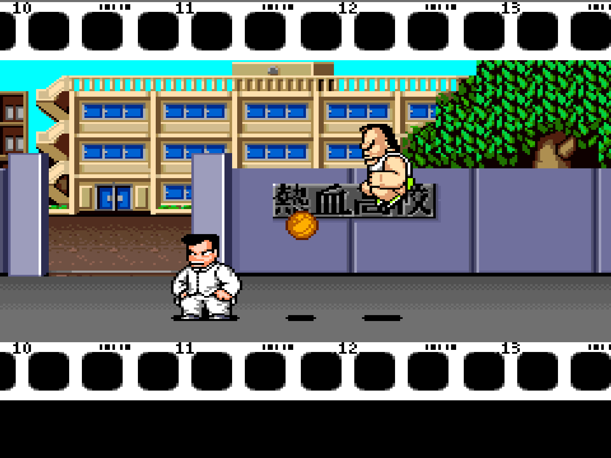
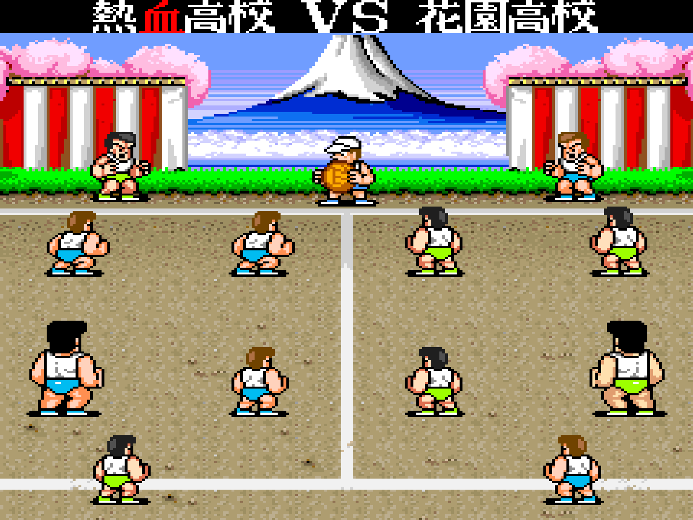
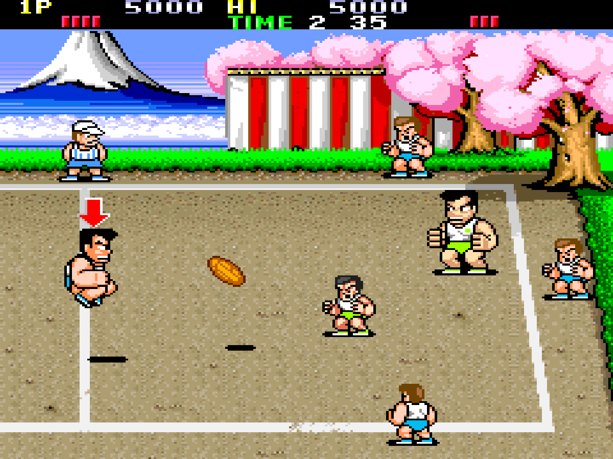
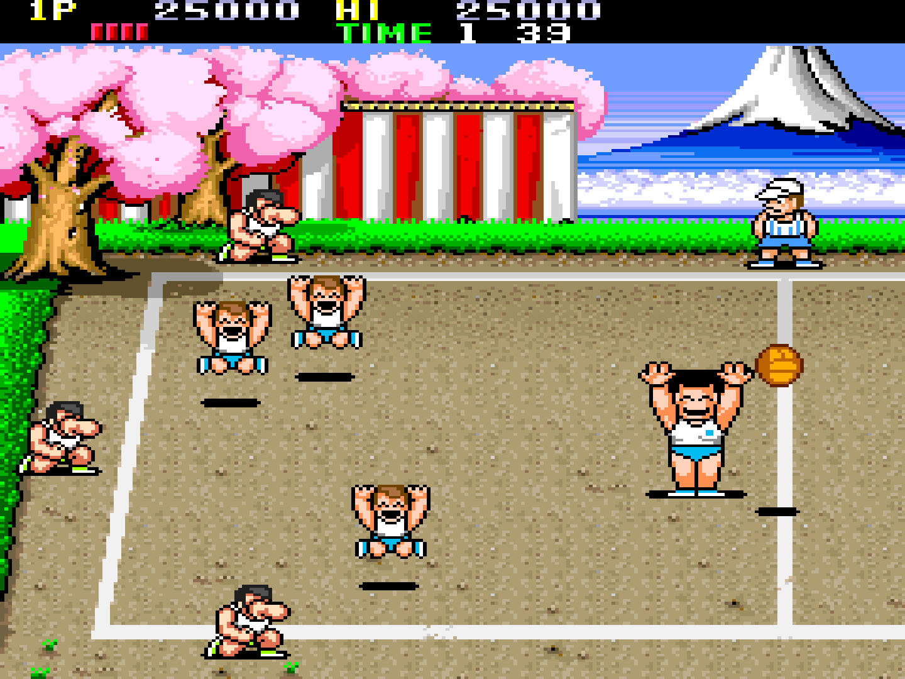
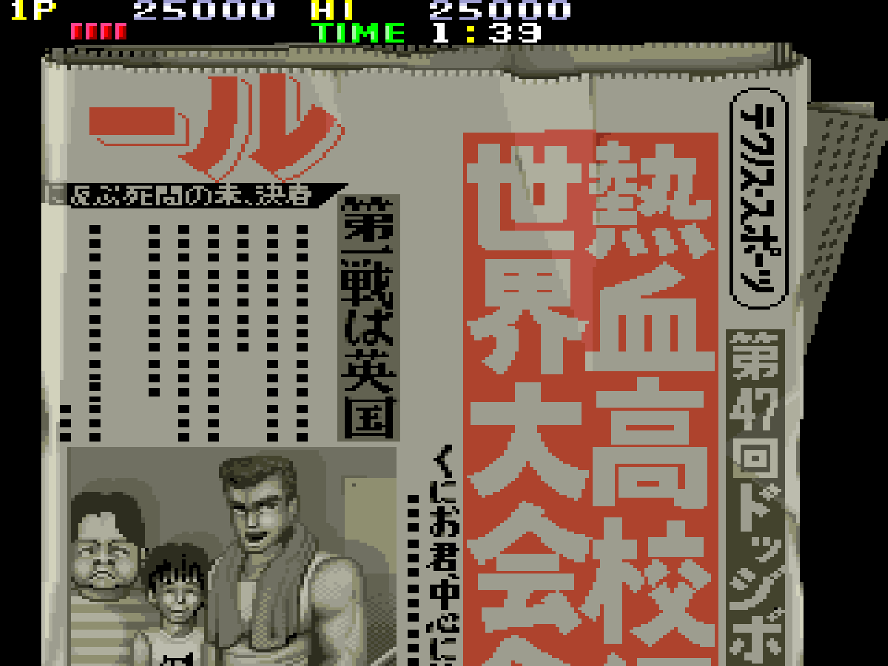
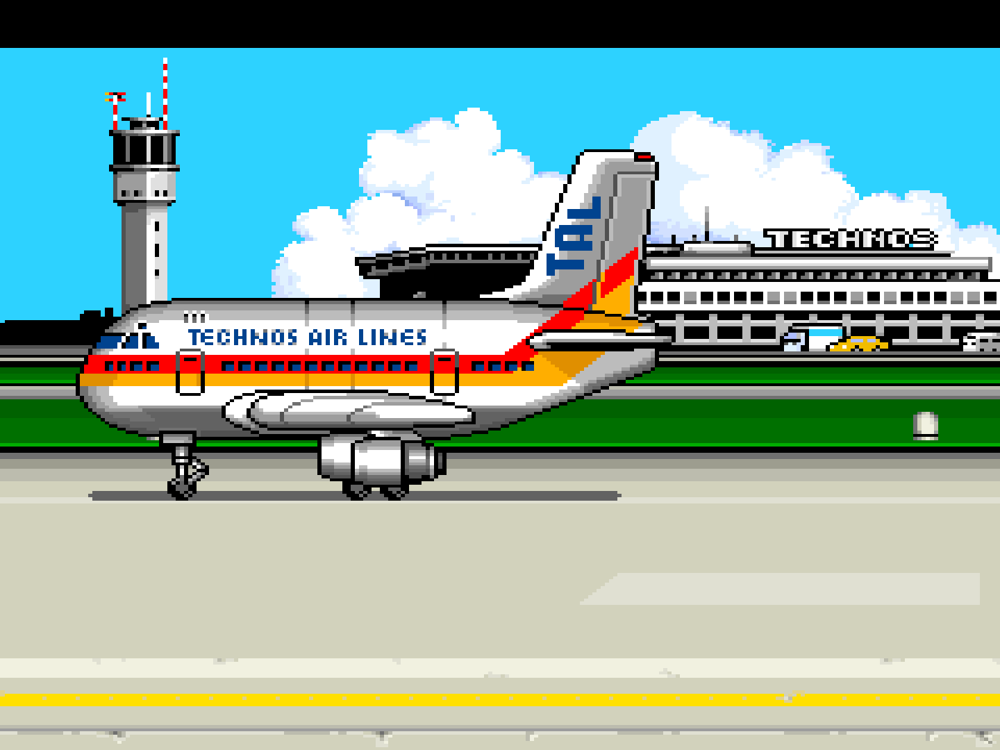
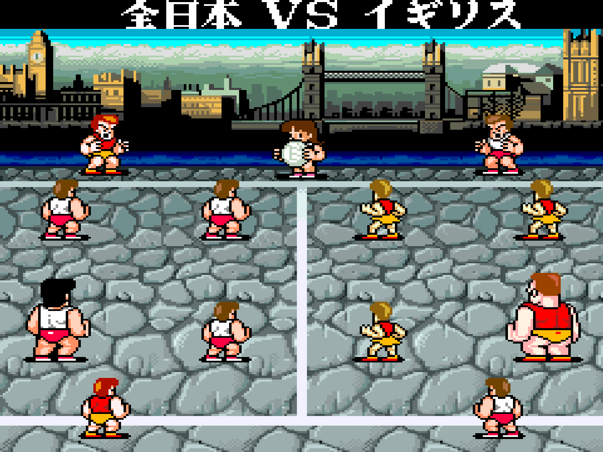

# Nekketsu — MiSTer용 Super Dodge Ball

[English](README.md) · 한국어 · [日本語](README.ja.md)

Technos Japan의 1987년 아케이드 게임 **Super Dodge Ball / 熱血高校ドッジボール部**의 MiSTer FPGA 코어입니다.

취미로 만든 프로젝트이며 **jotego의 공식 코어가 아닙니다.** jotego의 JTFRAME 프레임워크 위에 만들었고, 그의 Renegade와 Double Dragon 코어에서 많은 부분을 빌려 왔습니다.

## AI를 활용한 개발

이 코어는 AI 코딩 어시스턴트(Anthropic의 Claude, Claude Code)의 도움을 받아 개발했습니다.

## 지원 게임

| MAME 세트 | 제목 | MRA |
|---|---|---|
| `spdodgeb` | Super Dodge Ball (미국판) | `mra/Super Dodge Ball (US).mra` |
| `nkdodge` | Nekketsu Koukou Dodgeball Bu (일본판) | `mra/_alternatives/_Super Dodge Ball/Nekketsu Koukou Dodgeball Bu (Japan).mra` |

MAME와 마찬가지로 미국판이 parent, 일본판이 clone이라서 일본판 MRA는 `_alternatives` 아래에 있습니다. `mra/` 폴더 구조는 SD 카드의 `_Arcade/`와 같습니다.

부틀렉 `nkdodgeb`는 지원하지 않습니다. ROM은 들어 있지 않으니, 가지고 계신 MAME 세트(`nkdodge.zip`, `spdodgeb.zip`)를 `games/mame/`에 넣어 주세요.

## 스크린샷

일본판(`nkdodge`)을 MiSTer에서 찍은 화면이며, 게임 진행 순서대로 정리했습니다.

| | |
|---|---|
|  인트로: 교문 앞의 라이벌 |  하나조노 고교와의 첫 경기 |
|  상대 코트를 향한 슛 |  경기 승리 |
|  신문: 세계 대회 출전 |  영국으로 출발 |
|  런던에서 펼쳐지는 일본 대 영국 |  |

## 목표: 실기(PCB)처럼 동작하기

에뮬레이터를 따라 하는 것이 아니라, 원래 기판처럼 동작하는 것이 목표입니다. 자료마다 내용이 다를 때는 다음 순서로 판단합니다.

1. 원래 기판(실기 녹화 영상).
2. 같은 세대 Technos 형제 기판의 회로도. 주로 [jtcores](https://github.com/jotego/jtcores)에 다시 그려져 있는 Renegade(TA-0018) 회로도(`cores/kunio/sch`)입니다.
3. MAME의 `technos/spdodgeb.cpp` 드라이버. 게임 프로그램이 보는 부분(메모리 맵, 입출력, MCU)은 신뢰하고, 화면 타이밍은 참고로만 씁니다.

Super Dodge Ball 기판(TA-0022)의 회로도는 아직 공개된 것이 없는 것으로 압니다.

## 하드웨어

| 구성 요소 | 칩 | 구현 |
|---|---|---|
| 메인 CPU | 6502 @ 2MHz | `jt65c02` |
| 사운드 CPU | HD68A09P | `jtframe_sys6809`로 감싼 `mc6809i` |
| MCU (입력 처리, 프로텍션) | HD63701Y0 @ 4MHz (클럭 미확인) | 덤프된 ROM을 실행하는 `jt63701y` |
| FM | YM3812 | `jtopl2` |
| ADPCM | MSM5205 × 2 | `jt5205` |
| 영상 | 픽셀 클럭 6MHz, 전체 384 × 272, 보이는 영역 240 × 237 | `jtframe_vtimer`, `jtframe_scroll`, 자체 스프라이트 엔진 |
| 색 | 색 PROM 2개, R·G·B 채널당 4비트 | 자체 색 처리 모듈 |

## 현재 상태

동작하는 것:

- 두 세트 모두 부팅해서 MCU 검사를 통과하고 플레이할 수 있습니다.
- 음악, 효과음, 음성.
- 배경, 스프라이트, 색. 영상 타이밍은 형제 기판인 Renegade의 라인 카운터를 따릅니다. 화면은 실기처럼 240 × 237이고(MAME는 256 × 240을 9줄 위, 8픽셀 왼쪽에서부터 보여 줌), 점수판 아래 분할은 게임 자체의 IRQ 타이밍으로 생깁니다. 양쪽이 함께 보여 주는 줄에서는 데모 화면이 MAME와 픽셀 단위로 같고, 점수판 바로 아래 한 줄만 다릅니다(MAME는 그 줄을 점수판 스크롤로 그림).
- 레버를 같은 방향으로 두 번 입력해 달리기 (MCU 입력 처리).
- 일시정지 (JTFRAME, `P` 키).

알려진 문제:

- 플레이 중 코트가 스크롤될 때 가끔 스프라이트가 깜빡입니다. 실기에서는 스프라이트와 배경이 함께 움직입니다.
- 2인 플레이, DIP 스위치, 리셋은 아직 확인하지 않았습니다.
- 화면 뒤집기와 칵테일 모드는 지원하지 않습니다.

## 조작

8방향 조이스틱과 버튼 2개를 씁니다.

| 입력 | 동작 |
|---|---|
| 버튼 1 | 슛 |
| 버튼 2 | 패스 |
| 두 버튼 동시에 | 점프 |
| 레버를 같은 방향으로 빠르게 두 번 | 달리기 |

DIP 스위치(기본값은 MRA에 들어 있고 OSD에서 바꿀 수 있음): Coin A, Coin B, Demo Sounds, Difficulty, Allow Continue. 화면 뒤집기(Flip Screen)는 넣지 않았습니다.

## 빌드

[BUILD.md](BUILD.md)를 참고하세요. 이 코어는 [jtcores](https://github.com/jotego/jtcores) 저장소를 클론한 폴더 안에서 jotego의 `jtcore` 도구로 빌드합니다.

## 출처와 감사

- **Jose Tejada (jotego)**: JTFRAME, 그리고 이 코어의 바탕이 된 코어와 모듈: jtkunio(Renegade), jtdd(Double Dragon), `jt65c02`, `jt63701y`, `jtopl`, `jt5205`, `jtframe_scroll`, 그리고 Renegade 회로도. https://github.com/jotego/jtcores
- **Alexey Melnikov (sorgelig)와 MiSTer 프로젝트**: JTFRAME이 쓰는 MiSTer 프레임워크(`sys/`).
- **MAME**: Paul Hampson과 Nicola Salmoria의 `spdodgeb` 드라이버. 참고 자료로만 썼습니다(MAME 코드는 들어 있지 않음).
- **Technos Japan**: 원작 게임.

## 후원

이 코어는 무료이고 앞으로도 무료이며, 후원자 전용 기능은 없습니다. 마음에 드셨다면 [Ko-fi](https://ko-fi.com/intactio)에서 커피 한 잔을 후원해 주세요. 후원은 이 코어 개발에 대한 것이며 게임 대가가 아닙니다. ROM은 제공하지 않습니다.

## 라이선스

GPLv3입니다. [LICENSE](LICENSE)를 참고하세요. jtcores에서 가져온 부분은 원래의 GPLv3 라이선스와 저작권 헤더를 그대로 유지합니다.
